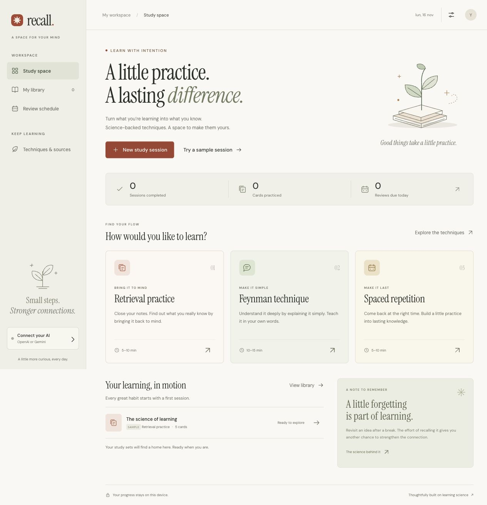
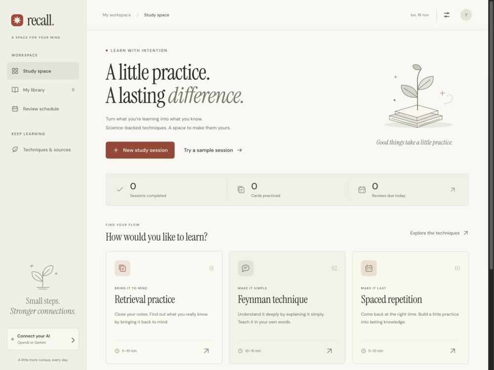
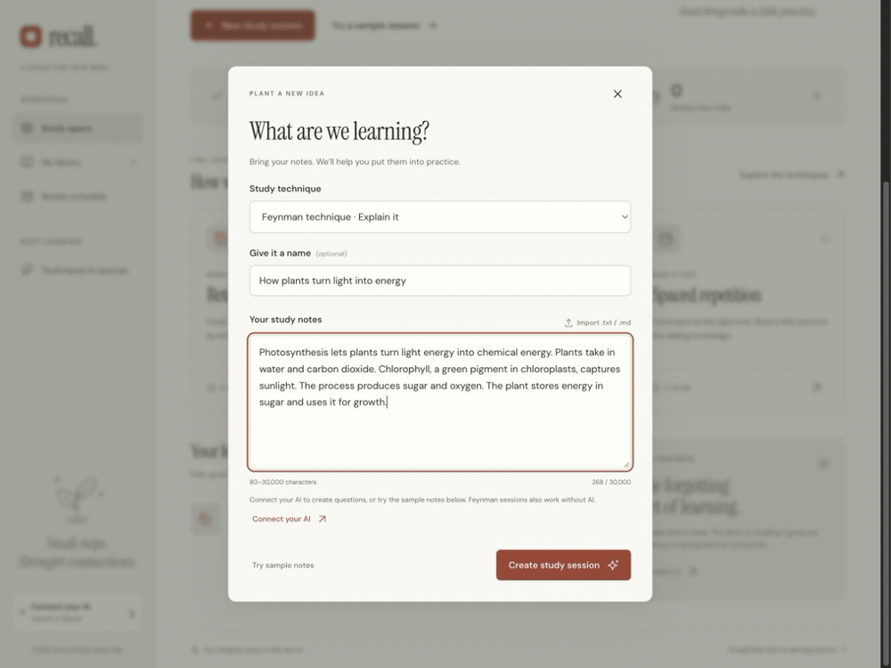
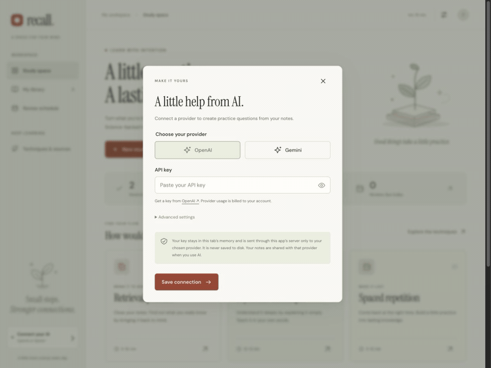

<div align="center">

# Recall

### A little practice. A lasting difference.

Turn your notes into questions, explain ideas in your own words, and return to them over time.

**Retrieval practice · Feynman technique · Spaced repetition**

[Get started](#-quick-start) · [Watch the demos](#-see-recall-in-action) · [AI setup](#-bring-your-own-ai) · [Guía en español](docs/GUIA.md) · [Sources](docs/SOURCES.md)



</div>

> **Try it before connecting anything.** The sample session and the complete Feynman reflection flow work without an API key. No installation or package downloads are needed to run the app.

## 🚀 Quick start

Requires **Node.js 22+**.

```sh
git clone https://github.com/esteban-rj/learning-techniques.git
cd learning-techniques
npm run dev
```

Open **[localhost:3000](http://localhost:3000)** and select **Try a sample session**.

Already cloned? Run `npm run dev` from the repository root. Use `npm start` without watch mode. `PORT` changes the port; `HOST` changes the default `127.0.0.1` binding.

The [hosted Recall site](https://recall-study-lab.estebanelias27.chatgpt.site) currently has **owner-only access**. Clone the repository to try your own local copy.

## 🎬 See Recall in action

These GIFs use **real browser captures**, demonstration notes, and no API keys. They show selected steps from longer sessions: reading time and intermediate questions are shortened. Counters belong to the demonstration workspace.

### 1. Recall it → compare it → revisit it

Write an answer **before** revealing the reference. Compare it, select **Got it** or **Needs practice**, and let Recall schedule the next review.



[Static preview](docs/media/retrieval-practice-poster.jpg) · Five sample questions, **no provider request**.

<details>
<summary><strong>2. Explain it simply with the Feynman technique</strong></summary>

Read your notes, hide them, and explain the idea to someone new. Compare with the source, fill the gaps, simplify your explanation, and save your reflection.



[Static preview](docs/media/feynman-technique-poster.jpg) · This walkthrough uses **manual reflection**, without AI coaching.

</details>

<details>
<summary><strong>3. Choose OpenAI or Gemini</strong></summary>

Open **AI settings** from the header or **Connect your AI** in the sidebar. Choose a provider, add a key, and optionally change the model under **Advanced settings**. Connect inside a new session without losing your notes.



[Static preview](docs/media/ai-settings-poster.jpg) · The key field stays empty. No live provider call is shown.

</details>

<details>
<summary><strong>4. Explore your library, review schedule, and research</strong></summary>

Find saved study sets, filter the library, check the seven-day calendar, and explore all ten techniques and all 16 references from the source article.


[Static preview](docs/media/library-and-sources-poster.jpg) · Progress stays in this browser on this device.

</details>

## 🧠 Pick your practice

| Technique | Your part | Recall handles | Key needed? |
| --- | --- | --- | --- |
| **Retrieval practice** | Answer from memory, compare, self-rate | Five questions from your notes, reference answers, progress, review dates | For generating new questions; not for the sample |
| **Feynman technique** | Read → explain → check gaps → simplify | Hidden notes during explanation, source comparison, saved reflection | Only for optional AI coaching |
| **Spaced repetition** | Review due cards and rate recall | Five Leitner boxes and a seven-day review calendar | For generating new cards; saved-card reviews are local |

Paste **80–30,000 characters** or import `.txt` / `.md` notes. The library supports search, deletion, and JSON export. Backup import and cross-device sync are not implemented.

<details>
<summary><strong>How the review schedule works</strong></summary>

Every card starts in **box 1**. Correct recall promotes it one box, capped at box 5. Incorrect recall moves it down one box, with box 1 as the minimum.

| Box after your rating | Next review |
| --- | --- |
| 1 | 1 day |
| 2 | 2 days |
| 3 | 4 days |
| 4 | 9 days |
| 5 | 14 days |

The first **Got it** moves a new card from box 1 to box 2 and schedules it two days later. Reviews use calendar days and the time of your rating on the device. The calendar includes cards due later today; the due queue includes only cards due now.

These are the USAHS article’s example intervals, not a personalized memory forecast. There are **no background notifications**. Self-ratings are your assessment, not a measured mastery score.

</details>

## ✨ Bring your own AI

1. Open **AI settings** and choose **OpenAI** or **Gemini**.
2. Paste a key from [OpenAI](https://platform.openai.com/api-keys) or [Google AI Studio](https://aistudio.google.com/apikey).
3. Save the connection and create a session from your notes.

| Provider | Default model | API |
| --- | --- | --- |
| OpenAI | `gpt-5-mini` | Responses with structured JSON and `store: false` |
| Gemini | `gemini-2.5-flash` | `generateContent` with a JSON response schema |

**Advanced settings** accepts another model ID available to your key that supports structured JSON output. Saving adds the key; the provider checks it on the first request. Usage is billed to the key’s account.

> **ChatGPT subscription vs. API key:** this version does not use a visitor’s ChatGPT subscription for inference. Hosting on ChatGPT Sites does not activate that integration. The current AI features use the provider key you supply.

<details>
<summary><strong>What happens to my key and notes?</strong></summary>

- Keys stay **only in the current tab’s memory**. Refreshing removes the connection.
- Keys are excluded from local/session storage, exports, source files, and application logs.
- Requests go through the app’s same-origin server to the chosen provider’s fixed HTTPS endpoint. Keys are sent in headers, never URL query strings.
- AI requests share your notes with that provider. OpenAI requests set `store: false`; provider data handling still follows its terms.
- Study sets and saved reflections persist in local storage. There is no encryption or cross-device sync.

Use HTTPS when deploying. Do not paste credentials or sensitive personal data into notes. The server validates request origin, JSON bodies, input limits, model IDs, and provider output. It limits request size and replaces raw provider errors with actionable messages. Generated text is escaped before display. Check AI questions and feedback against the original source.

</details>

## 🛠️ Development

```sh
npm run dev   # Local server with watch mode
npm start     # Local server without watch mode
npm test      # Provider contracts, validation, scheduling, persistence
npm run build # Cloudflare Worker with embedded frontend assets
```

The **21 automated tests** cover mocked OpenAI/Gemini generation and feedback, invalid requests, output validation, redacted errors, body/origin protection, cancellation, Leitner scheduling, and storage recovery. Desktop and mobile flows were checked in the browser. Live paid requests require a working key and are not part of the automated suite.

```text
learning-techniques/
├── recall/
│   ├── public/       # Dependency-free HTML, CSS, and JavaScript
│   ├── server/       # Local Node server and shared provider adapter
│   ├── scripts/      # Worker build
│   ├── test/         # Node's built-in test runner
│   └── .openai/      # Existing private Site identity
├── docs/             # Spanish guide, sources, capture notes, and GIFs
└── scripts/          # Documentation GIF encoding
```

No build-time provider secrets are required. The ignored Worker output is `recall/dist/server/index.js`. Publishing is separate from `npm run build`. The committed Site ID belongs to the existing owner-private deployment; provision your own Site identity before deploying a fork.

To update the visuals, follow the [capture and GIF guide](docs/CAPTURES.md). FFmpeg is needed **only** to rebuild documentation GIFs, not to run Recall.

## 🌱 Foundations

Based on [USAHS: 10 study methods and tips](https://www.usa.edu/blog/study-techniques/) and its linked resources. See the [complete reading list and technique mapping](docs/SOURCES.md).

The interface follows **userinterface-wiki**: progressive disclosure, comfortable targets, visible keyboard focus, restrained feedback, tabular progress numbers, and reduced-motion support. DM Sans and Instrument Serif have system/Georgia fallbacks. No analytics or third-party scripts are used.

[MIT License](LICENSE).
