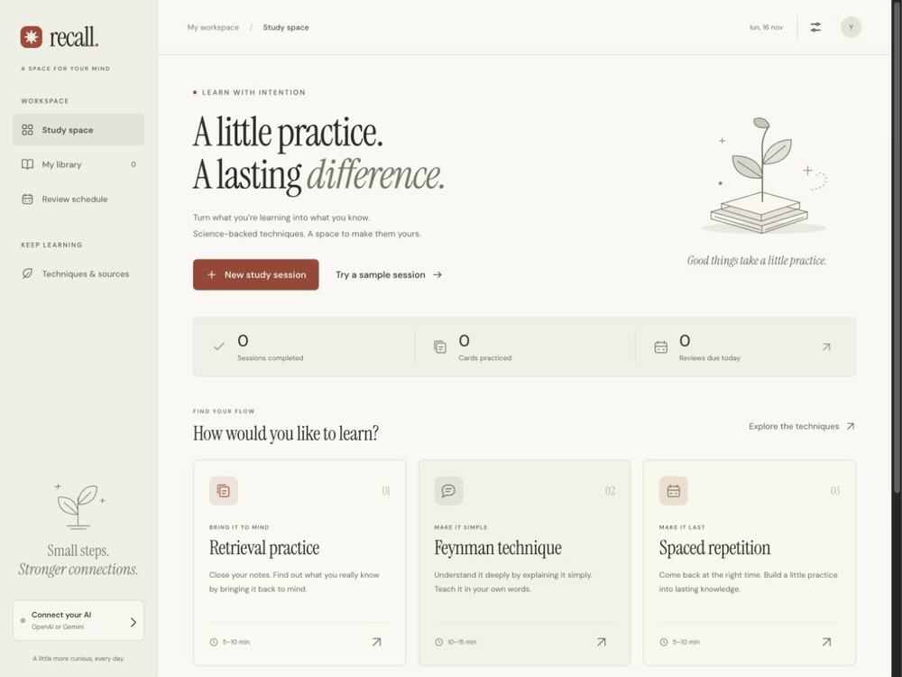
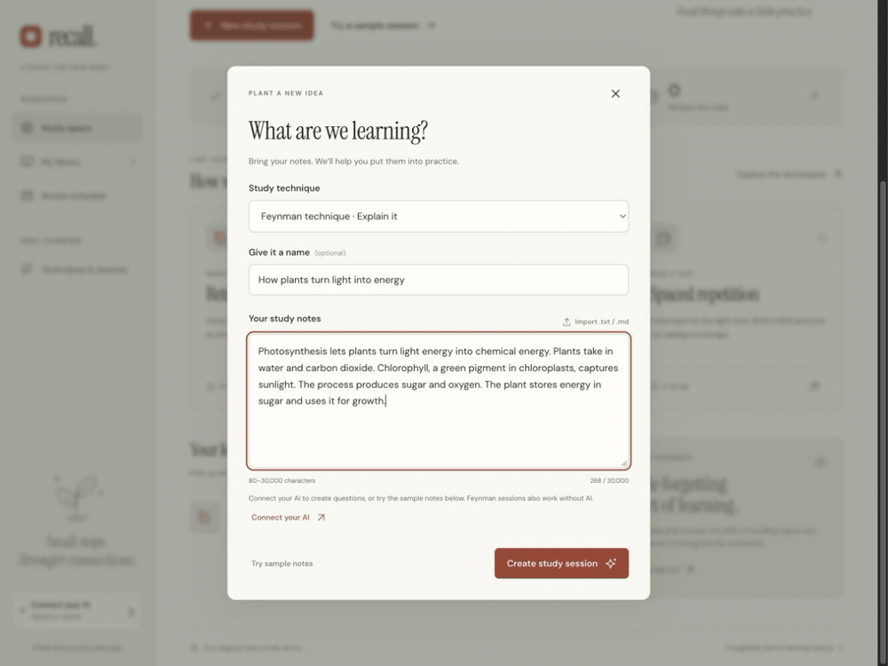
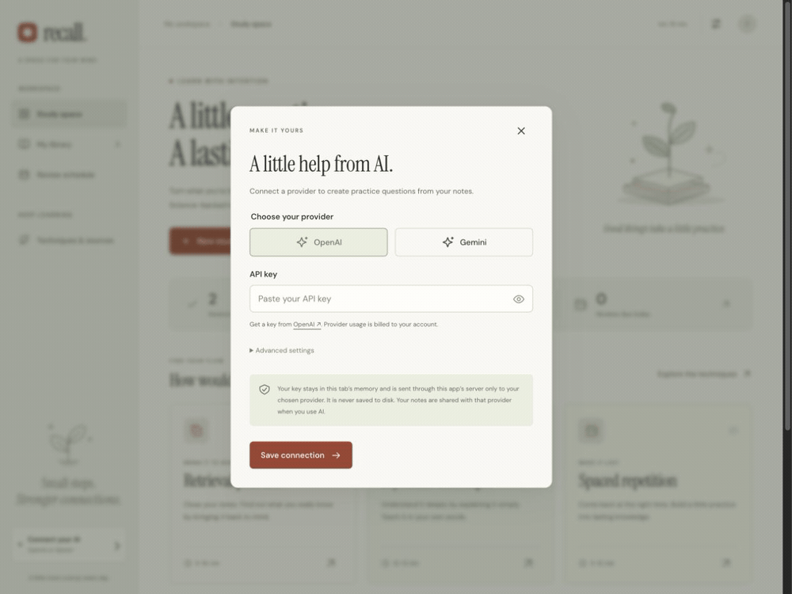
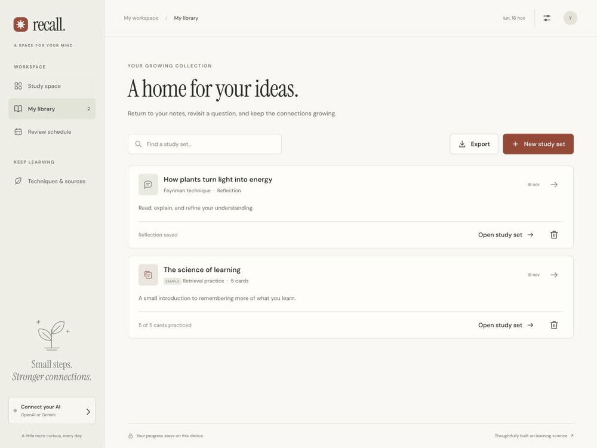

# Recall · Guía rápida

[← README](../README.md) · [Fuentes](SOURCES.md) · [Capturas y GIFs](CAPTURES.md)

Convierte tus apuntes en práctica: recuerda una respuesta, explica una idea con claridad y vuelve a ella después de un intervalo.

## Pruébalo sin configurar una API

Necesitas **Node.js 22 o superior**. No hay dependencias que instalar.

```sh
git clone https://github.com/esteban-rj/learning-techniques.git
cd learning-techniques
npm run dev
```

Abre [localhost:3000](http://localhost:3000) y pulsa **Try a sample session**. El sitio publicado tiene acceso privado para su propietario; tu copia local funciona por separado.

## Recuperación activa: recuerda antes de comparar



1. Lee la pregunta sin abrir tus notas.
2. Escribe lo que recuerdas en **Your answer**.
3. Pulsa **Compare answer** para ver la referencia.
4. Compara y selecciona **Got it** o **Needs practice**.
5. Al terminar, abre **See your review schedule**.

Si no recuerdas la respuesta, **I couldn’t recall it** permite revelarla. La autoevaluación no es una calificación automática. La muestra tiene cinco preguntas preparadas y no realiza llamadas de IA; generar preguntas de tus propios apuntes sí necesita una clave.

## Feynman: explícalo con tus palabras

<details>
<summary><strong>Ver el recorrido animado</strong></summary>



</details>

1. Elige **Feynman technique**, pega tus apuntes y crea la sesión.
2. Léelos y pulsa **I’m ready to explain**. Los apuntes se ocultan.
3. Explica el concepto con palabras sencillas y un ejemplo.
4. Pulsa **Compare with notes**, identifica lo que faltó y corrige tu explicación.
5. Marca la comprobación de reflexión y pulsa **Save my reflection**.

Todo este recorrido funciona sin clave. **Get AI feedback** es una ayuda opcional que utiliza el proveedor conectado; comprueba sus observaciones contra tus apuntes.

## Repetición espaciada: vuelve cuando corresponda

Cada tarjeta empieza en la caja 1 del sistema Leitner. **Got it** la sube una caja; **Needs practice** la baja, entre las cajas 1 y 5.

| Caja después de evaluar | Próximo repaso |
| --- | --- |
| 1 | En 1 día |
| 2 | En 2 días |
| 3 | En 4 días |
| 4 | En 9 días |
| 5 | En 14 días |

El primer **Got it** lleva una tarjeta nueva a la caja 2, con revisión dos días después. **Review schedule** muestra el calendario y las tarjetas que ya están vencidas. Los intervalos son el ejemplo del artículo de USAHS, no una predicción personalizada. No hay notificaciones en segundo plano.

## Conecta OpenAI o Gemini

<details>
<summary><strong>Ver la configuración de ambos proveedores</strong></summary>



</details>

Abre el botón de ajustes de la cabecera o **Connect your AI** en la barra lateral. Selecciona el proveedor, pega tu clave y pulsa **Save connection**. También puedes conectarlo dentro del formulario de una sesión sin perder tus notas.

| Proveedor | Obtener clave | Modelo inicial |
| --- | --- | --- |
| OpenAI | [API keys](https://platform.openai.com/api-keys) | `gpt-5-mini` |
| Gemini | [Google AI Studio](https://aistudio.google.com/apikey) | `gemini-2.5-flash` |

**Advanced settings** permite usar otro modelo disponible para tu cuenta y compatible con JSON estructurado. Guardar la conexión no confirma permisos, cuota ni saldo: la clave se comprueba al hacer la primera solicitud.

La clave vive solamente en la memoria de esa pestaña. Al recargar, debes conectarla de nuevo. No se guarda en el código, las exportaciones ni el almacenamiento del navegador. El servidor la envía con tus notas al proveedor elegido, que factura el consumo a la cuenta de esa clave.

**La versión publicada no consume automáticamente la suscripción de ChatGPT del visitante.** Alojar Recall en Sites y habilitar el uso del plan de ChatGPT son integraciones distintas. La IA actual usa las API keys de OpenAI o Gemini.

## Biblioteca, calendario y fuentes

<details>
<summary><strong>Ver navegación y búsquedas</strong></summary>



</details>

- **My library:** busca sesiones, vuelve a estudiarlas, elimínalas o exporta una copia JSON.
- **Review schedule:** consulta cuándo volver a tus tarjetas.
- **Techniques & sources:** explora las diez técnicas y las 16 referencias del artículo.

Los conjuntos y las reflexiones se guardan en este navegador. No hay cifrado, sincronización entre dispositivos ni importación de copias JSON. Exporta lo que quieras conservar antes de borrar los datos del navegador.

## Si algo falla

| Situación | Qué revisar |
| --- | --- |
| La muestra funciona, pero no genera nuevas preguntas | Conecta una clave en **AI settings**. |
| El proveedor rechaza la clave | Comprueba el proveedor elegido y los permisos de API. |
| Aparece un límite de cuota | Revisa límites y facturación; vuelve a intentarlo más tarde. |
| El modelo no está disponible | Cambia su ID en **Advanced settings**. |
| No hay repasos vencidos | El calendario muestra también tarjetas futuras; la cola se habilita cuando llega su fecha y hora. |
| La conexión desapareció al recargar | Es normal: las claves no se guardan. |
| El puerto 3000 está ocupado | Ejecuta `PORT=4173 npm run dev` y abre [localhost:4173](http://localhost:4173). |

Verifica el proyecto con `npm test` y `npm run build`. Las pruebas de proveedores usan respuestas simuladas, sin consumir una clave ni demostrar una llamada de pago real.
